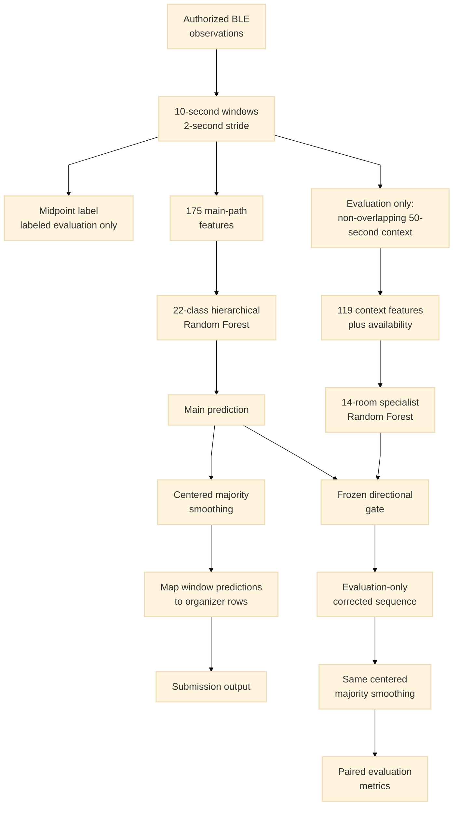
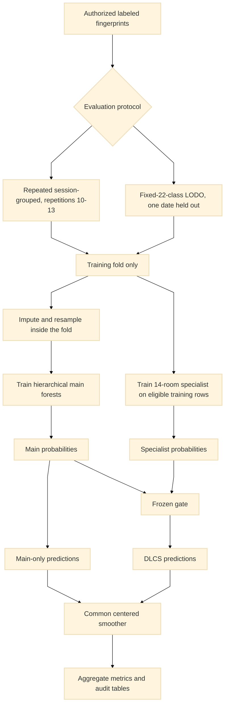
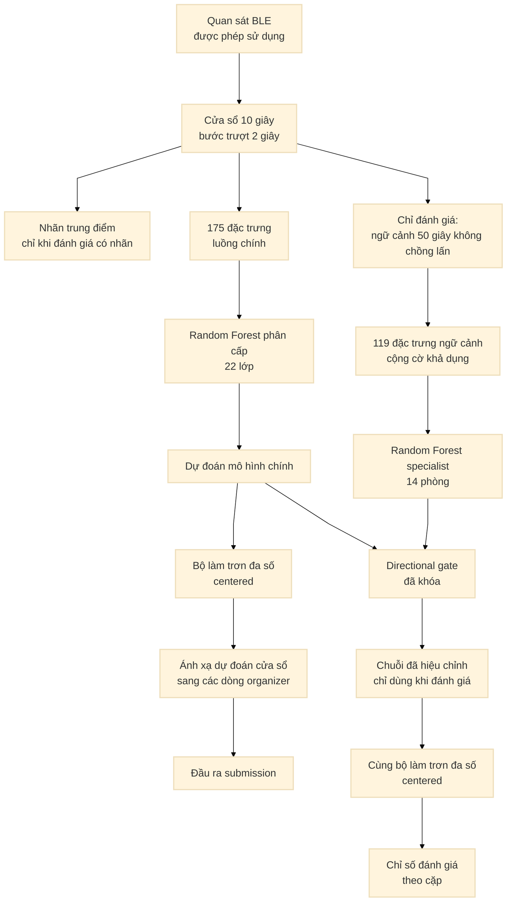
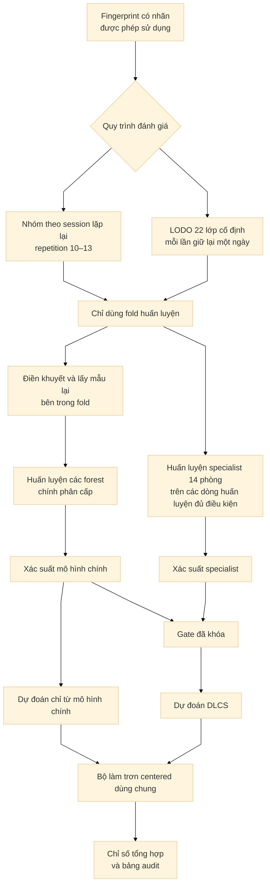

# BLE Indoor Location Prediction — ISAS 2026

Paper 139 passed both the ISAS 2026 paper review and presentation round. The revised paper was submitted through Morressier for IOP review on November 3, 2026; the captured portal status is “In Review.”

I led the SQ3K team and built the end-to-end system described here.

## My Contributions

- **Data preparation and features**
  - Reconstructed and integrity-checked the fingerprint table (15,382 rows, 22 classes, 175 numeric features).
  - Aligned BLE events with location labels; built 10-second windows, 2-second strides, midpoint labels, and 50-second context features.
  - Added a preparation workflow for authorized archives; this rebuild maps private archive members through a local manifest.
- **Models and correction**
  - Built the two-level 22-class Random Forest and fold-local oversampling pipeline.
  - Built the 14-room long-context specialist and frozen directional correction gate.
  - Implemented the centered smoother used in both evaluation and the locked main-model inference path.
- **Evaluation and inference**
  - Ran the repeated session-grouped and fixed-class leave-one-day-out workflows; documented the limits of the visit-level audit where its source output is unavailable.
  - Kept hidden-test inference on the main model plus centered smoothing; it does not use the specialist or gate.
- **Reproducibility**
  - Maintained the training and evaluation notebooks, scripts, and fingerprint integrity check. The [contribution record](docs/contribution-evidence.md) separates source-backed code history from author-reported work.

## Task and system

This project predicts one of 22 indoor location classes from Bluetooth Low Energy (BLE) signal observations. The main path turns timestamped observations from 25 beacons into overlapping 10-second fingerprints. A two-level hierarchical Random Forest is the default predictor. During labeled-data evaluation, a 14-room specialist can propose a narrow set of corrections using label-free 50-second context. A frozen gate decides whether each correction is allowed.

The submitted paper is included byte for byte at [paper/ISAS2026_Paper139_Full_Paper.pdf](paper/ISAS2026_Paper139_Full_Paper.pdf). Its source and copy have the same SHA-256: `D220C3836266D706A34D98E088AEE0415C0165E3B34B70AFAF80E63FD59D5735`. The former repository PDF was a different, older document and was removed from this rebuilt worktree.

### Inference paths

The hidden-test inference script follows the main path and centered smoothing. It does not call the specialist or gate. The specialist branch is used for labeled-data comparisons only.

### Training and evaluation

## Method at a glance

- **Main windows:** 10 seconds long, stride 2 seconds. Each window receives the location label whose interval contains its midpoint.
- **Main features:** 25 beacons × 5 current-window values (mean RSSI, presence, population standard deviation, maximum RSSI, and packet count), plus 25 × 2 summaries over the previous eight retained windows: mean packet count and mean RSSI standard deviation. Total: 175 numeric features.
- **Missing values:** absent mean and maximum RSSI use -125; other missing main features use zero.
- **Main model:** two-level Random Forest, first routing numbered rooms versus common areas, then predicting a specific class. Each forest has 400 trees, square-root feature subsampling, and balanced-subsample class weights.
- **Fold-local resampling:** random oversampling raises classes with fewer than 6 training examples to 6; Borderline-SMOTE-1 then raises classes below support 200 to 200. Resampling is fit inside each training fold.
- **Specialist:** non-overlapping 50-second BLE context bins, 119 named numeric features plus an availability flag, and a 1,200-tree Random Forest over 14 room classes. The context is label-free. Because a complete bin is joined to a window by its midpoint bin key, specialist context may include observations after that 10-second midpoint; this is an offline batch feature, not a causal streaming feature.
- **Gate:** frozen `strong_plus_local`, `alpha = 0.75`, main top-two margin at most 0.30, protected sources `{501, 502, 516, 522, 523}`, and active targets `{508, 510, 513, 515, 518, 520}`. The target clusters, required eligibility checks, and inactive pair overrides are listed in [Method and configuration](docs/method.md).
- **Smoothing:** common centered majority smoothing within ordered sequences: radius 15 (31 positions), hallway radius 2 (5 positions), clipped at sequence edges. For classes 501, 513, and 515, preserve the original label when the run is at least 3 or its vote share is below 0.70. This uses future as well as past predictions and is offline/noncausal.

See [Method and configuration](docs/method.md) for the complete gate and preprocessing details.

## Results and limits

The authoritative results and evaluation labels are in [Results](docs/results.md). The repeated session-grouped result is an optimistic within-period diagnostic: main Macro-F1 is 0.5367 ± 0.0116 and DLCS is 0.5487 ± 0.0158. The submitted paper reports that 80 of 332 visits cross session groups and that 44.3–44.8% of validation windows have another window from the same visit in training. Those visit-level values are **untraced to a saved audit output** in the handoff reviewed here.

In fixed-22-class four-fold LODO, raw Macro-F1 is 0.3647 for the main model and 0.3680 for DLCS. With common centered smoothing, it is 0.4026 for the main model and 0.3993 for DLCS. Smoothing reverses the small raw ordering; the smoothed DLCS result does not improve on the main model. The evaluation covers four dates at one facility, is not forward-chaining, and does not use nested day-level model selection. Four classes have zero smoothed LODO F1: 503, 505, 508, and 510.

Table 6 is preserved exactly as submitted. Its baseline rows were not independently rerun in this rebuild. No organizer-held test labels or hidden-test performance metrics are available.

## Data governance and authorized reproduction

Challenge data are not included. Use only data that you are authorized to access and keep the archive, local manifest, runtime data, labels, predictions, and caches outside the repository. The code and notebooks use generic logical input roles and runtime aliases; the actual archive member names belong in a local manifest that is not committed.

The user-approved geometry files [config/beacon_coords.json](config/beacon_coords.json) and [config/room_centers.json](config/room_centers.json) remain unchanged. They describe floor-layout coordinates. See [Data governance](docs/data.md) for the data contract and privacy boundary.

After obtaining authorized data and creating a local JSON manifest that maps the required logical roles to archive members:

1. Install the pinned packages from [requirements.txt](requirements.txt).
2. Prepare a runtime directory outside the worktree with `python scripts/prepare_data.py --archive <private-archive> --manifest <local-manifest> --out <private-runtime>/Dataset`.
3. Rebuild and compare the public fingerprint integrity reference with `python scripts/verify_fingerprints.py --data-root <private-runtime>/Dataset --out <private-runtime>/rebuilt_fingerprints.csv`.
4. Consult [Reproducibility](docs/reproducibility.md) before choosing a labeled-data evaluation command.

These steps are an authorized reproduction path, not a request to rerun model experiments as part of this rebuild. The separate hidden-input inference script and notebook exist, but were not run here. CLI data and output paths must resolve outside and must not contain the clone. By default, the inference submission is written to `<private-root>/test_inference/submission.csv`; the root is `/content/ISAS2026-private` in Colab and a sibling `<repo-name>-private` directory on a local machine. Set `ISAS2026_PRIVATE_DIR` to select another location. The recorded CSV hash below is an integrity reference only; the CSV and per-row predictions are not distributed.

## Locked artifact references

| Artifact | Recorded value | Meaning |
|---|---|---|
| Rebuilt training fingerprints | 15,382 rows × 175 numeric features; 22 classes | Labeled-data reconstruction reference |
| Fingerprint table SHA-256 | `d95ce428732af277c74bf8bd3fb16301c9aaeddbbb1c46a6b394905bfe5b3877` | Integrity check only |
| Hidden-test mapping | 62,222 organizer rows; 4,690 windows | Count reported by the locked inference record |
| Hidden-test CSV SHA-256 | `4b1a80a214b53b531a40467a515e2afbe4350b7b0533144ec1415c3eb9a43d80` | Integrity reference only; no CSV or predictions are included |
| Submitted paper source and copy SHA-256 | `D220C3836266D706A34D98E088AEE0415C0165E3B34B70AFAF80E63FD59D5735` | Byte identity check |

## Reproduction environment

The repository pins Python package versions in `requirements.txt`. The workflow uses Python, pandas, NumPy, scikit-learn, imbalanced-learn, and Jupyter/Colab for the notebooks. The recorded methodology does not establish a specific GPU requirement; the Random Forest workflow is CPU-oriented. The reference fingerprint and result files are snapshots, not guarantees that every platform will reproduce bit-for-bit outputs.

## Repository map

| Path | Purpose |
|---|---|
| `src/build_fingerprints.py` | 10-second fingerprint construction |
| `src/models/` | Hierarchical Random Forest and fold-local resampling |
| `src/dlcs/` | Context features, gate, validation, and smoothing |
| `scripts/` | Generic archive preparation, integrity check, and labeled-data evaluation entry points |
| `notebooks/` | Training/evaluation walkthroughs with no saved outputs |
| `config/` | Versioned beacon and room geometry |
| `results/` | Aggregate labeled-data metrics only |
| `paper/` | Byte-identical submitted manuscript |
| `docs/` | Method, results, evidence, data policy, benchmark, and work log |

## Citation and rights

The paper included here is the author-designated submitted manuscript, not evidence of a published journal article or DOI. The organizer email confirms that Paper 139 passed paper review and advanced to presentations; the author confirms it passed the presentation round. The Morressier record shows the submitted revision “In Review”; no later IOP decision is included in the available evidence.

Dao, Tien Khoa, Le Nam Khanh Nguyen, Nguyen Khoi Sang Vo, Lam Khanh Nguyen, and Phan Anh Quan Do. “ISAS Challenge 2026: Directional Long-Context Specialist Correction for Imbalanced BLE Location Prediction.” Submitted manuscript, 2026. The manuscript was resubmitted for IOP review on November 3, 2026; the captured Morressier state is “In Review.” No DOI or published-version metadata is established by the reviewed sources.

Related references verified against publisher records:

- Garcia, C. A., Vu, Q. N. P., Kaneko, H., and Inoue, S. “A Relabeling Approach to Signal Patterns for Beacon-based Indoor Localization in Nursing Care Facility.” *International Journal of Activity and Behavior Computing*, 2024, volume 2024, issue 1, pages 1–19, DOI 10.60401/ijabc.12. [J-STAGE record](https://www.jstage.jst.go.jp/article/ijabc/2024/1/2024_12/_article/-char/en).
- Widiyanto, A., et al. “A Hierarchical Classification Approach for Beacon-Based Indoor Localization in Nursing Care Facilities.” *International Journal of Activity and Behavior Computing*, 2026, volume 2026, issue 2, pages 1–17, DOI 10.60401/ijabc.161. [J-STAGE record](https://www.jstage.jst.go.jp/article/ijabc/2026/2/2026_161/_article/-char/en).
- Garcia, C. and Inoue, S. “Relabeling for Indoor Localization Using Stationary Beacons in Nursing Care Facilities.” *Sensors*, 2024, 24(2), 319, DOI 10.3390/s24020319. [Publisher record](https://www.mdpi.com/1424-8220/24/2/319), [PubMed record](https://pubmed.ncbi.nlm.nih.gov/38257412/).

The paper cites “From Sensors to Semantics: An Overview of BLE-Based Indoor Localization.” The local handoff did not establish an authoritative publication record for that title; its DOI and publication details remain unresolved. See [Open questions](docs/open-questions.md).

The repository’s MIT license covers the repository software only. It does not grant rights to the submitted paper, challenge data, or organizer materials. Paper rights remain with their respective rights holders; challenge data use remains subject to the organizer’s terms and the user’s access authorization. See [Data governance](docs/data.md).

## Documentation index

- [Method and configuration](docs/method.md)
- [Results and caveats](docs/results.md)
- [Data governance](docs/data.md)
- [Authorized reproduction](docs/reproducibility.md)
- [Evidence ledger](docs/evidence-ledger.md)
- [Contribution evidence](docs/contribution-evidence.md)
- [Ten-repository benchmark](docs/repository-benchmark.md)
- [Agent work log](docs/agent-work-log.md)
- [Open questions](docs/open-questions.md)
- [Change and verification report](CHANGE_AND_VERIFICATION_REPORT.md)

---

# Bản tiếng Việt

## Dự đoán vị trí trong nhà bằng BLE — ISAS 2026

Bài báo số 139 đã vượt qua cả vòng phản biện bài báo và vòng thuyết trình của ISAS 2026. Bản sửa đã được gửi qua Morressier để IOP phản biện vào ngày 3 tháng 11 năm 2026; trạng thái trên cổng thông tin được chụp lại là “In Review”.

Tôi dẫn dắt nhóm SQ3K và xây dựng hệ thống đầu-cuối được mô tả ở đây.

## Đóng góp của tôi

- **Chuẩn bị và tạo đặc trưng dữ liệu**
  - Tái dựng và kiểm tra tính toàn vẹn của bảng fingerprint (15.382 dòng, 22 lớp, 175 đặc trưng số).
  - Căn chỉnh sự kiện BLE với nhãn vị trí; tạo cửa sổ 10 giây, bước trượt 2 giây, nhãn tại trung điểm và đặc trưng ngữ cảnh 50 giây.
  - Bổ sung quy trình chuẩn bị dữ liệu cho archive được phép sử dụng; bản rebuild này ánh xạ thành viên archive riêng tư qua manifest cục bộ.
- **Mô hình và hiệu chỉnh dự đoán**
  - Xây dựng Random Forest hai tầng cho 22 lớp và quy trình oversampling theo từng fold.
  - Xây dựng mô hình chuyên biệt ngữ cảnh dài cho 14 phòng và directional correction gate đã khóa.
  - Cài đặt bộ làm trơn centered dùng trong đánh giá và luồng inference đã khóa của mô hình chính.
- **Đánh giá và inference**
  - Chạy quy trình đánh giá lặp theo nhóm session và leave-one-day-out với số lớp cố định; ghi rõ giới hạn của audit theo lượt thăm khi không có đầu ra nguồn.
  - Giữ inference hidden-test ở luồng mô hình chính cộng bộ làm trơn centered; không dùng specialist hoặc gate.
- **Khả năng tái lập**
  - Duy trì notebook huấn luyện/đánh giá, các script và bước kiểm tra tính toàn vẹn fingerprint. [Hồ sơ đóng góp](docs/contribution-evidence.md) phân biệt lịch sử mã nguồn có bằng chứng với nội dung do tác giả báo cáo.

## Bài toán và hệ thống

Dự án dự đoán một trong 22 lớp vị trí trong nhà từ tín hiệu Bluetooth Low Energy (BLE). Luồng chính chuyển quan sát có dấu thời gian từ 25 beacon thành fingerprint chồng lấn dài 10 giây. Bộ dự đoán mặc định là Random Forest phân cấp hai tầng. Khi đánh giá trên dữ liệu có nhãn, một specialist cho 14 phòng có thể đề xuất một số hiệu chỉnh hẹp bằng ngữ cảnh 50 giây không dùng nhãn. Một gate đã khóa quyết định có chấp nhận từng hiệu chỉnh hay không.

Bài báo đã nộp được đưa vào nguyên byte tại [paper/ISAS2026_Paper139_Full_Paper.pdf](paper/ISAS2026_Paper139_Full_Paper.pdf). SHA-256 của tệp nguồn và bản sao trùng nhau: `D220C3836266D706A34D98E088AEE0415C0165E3B34B70AFAF80E63FD59D5735`. PDF cũ trong repository là tài liệu khác, cũ hơn và đã được bỏ khỏi worktree rebuild này.

### Các luồng inference

Script inference hidden-test đi theo luồng mô hình chính và bộ làm trơn centered. Nó không gọi specialist hoặc gate. Nhánh specialist chỉ dùng để so sánh trên dữ liệu có nhãn.

### Huấn luyện và đánh giá

## Tóm tắt phương pháp

- **Cửa sổ chính:** dài 10 giây, bước trượt 2 giây. Mỗi cửa sổ nhận nhãn vị trí của khoảng nhãn chứa trung điểm cửa sổ.
- **Đặc trưng chính:** 25 beacon × 5 giá trị trong cửa sổ hiện tại (RSSI trung bình, trạng thái hiện diện, độ lệch chuẩn tổng thể, RSSI lớn nhất và số gói), cộng 25 × 2 giá trị tóm tắt trên tám cửa sổ được giữ lại trước đó: số gói trung bình và độ lệch chuẩn RSSI trung bình. Tổng cộng: 175 đặc trưng số.
- **Giá trị thiếu:** RSSI trung bình và lớn nhất bị thiếu dùng -125; các đặc trưng chính bị thiếu khác dùng 0.
- **Mô hình chính:** Random Forest hai tầng, trước tiên định tuyến giữa phòng được đánh số và khu vực chung, sau đó dự đoán lớp cụ thể. Mỗi forest có 400 cây, lấy mẫu đặc trưng theo căn bậc hai và trọng số lớp `balanced_subsample`.
- **Resampling trong từng fold:** random oversampling tăng các lớp có ít hơn 6 mẫu huấn luyện lên 6; sau đó Borderline-SMOTE-1 tăng các lớp có support dưới 200 lên 200. Quá trình resampling được fit bên trong từng fold huấn luyện.
- **Specialist:** các bin ngữ cảnh BLE không chồng lấn dài 50 giây, 119 đặc trưng số có tên cộng cờ khả dụng và Random Forest 1.200 cây trên 14 lớp phòng. Ngữ cảnh không dùng nhãn. Vì cả bin hoàn chỉnh được ghép với cửa sổ theo khóa bin trung điểm, ngữ cảnh specialist có thể chứa quan sát sau trung điểm của cửa sổ 10 giây; đây là đặc trưng batch offline, không phải đặc trưng streaming nhân quả.
- **Gate:** cấu hình `strong_plus_local` đã khóa, `alpha = 0.75`, độ chênh xác suất top-two của mô hình chính tối đa 0.30, nguồn được bảo vệ `{501, 502, 516, 522, 523}` và đích hoạt động `{508, 510, 513, 515, 518, 520}`. Các cụm đích, điều kiện đủ và override cặp không hoạt động được liệt kê trong [Phương pháp và cấu hình](docs/method.md).
- **Làm trơn:** làm trơn đa số centered dùng chung trong từng chuỗi có thứ tự: bán kính 15 (31 vị trí), hành lang dùng bán kính 2 (5 vị trí), cắt cửa sổ ở biên chuỗi. Với các lớp 501, 513 và 515, giữ nhãn ban đầu nếu chuỗi liên tiếp dài ít nhất 3 hoặc tỷ lệ phiếu dưới 0.70. Phương pháp dùng dự đoán cả trước lẫn sau, nên là offline/phi nhân quả.

Xem [Phương pháp và cấu hình](docs/method.md) để biết đầy đủ chi tiết về gate và tiền xử lý.

## Kết quả và giới hạn

Kết quả chuẩn và nhãn đánh giá được ghi trong [Kết quả](docs/results.md). Kết quả session-grouped lặp lại là chẩn đoán lạc quan trong cùng giai đoạn: Macro-F1 của mô hình chính là 0.5367 ± 0.0116 và DLCS là 0.5487 ± 0.0158. Bài báo nộp báo cáo 80 trong 332 lượt thăm đi qua các nhóm session và 44.3–44.8% cửa sổ validation có một cửa sổ khác cùng lượt thăm trong tập huấn luyện. Các giá trị theo lượt thăm này **chưa truy vết được đến đầu ra audit đã lưu** trong handoff được rà soát ở đây.

Trong LODO bốn fold với 22 lớp cố định, Macro-F1 raw là 0.3647 cho mô hình chính và 0.3680 cho DLCS. Với cùng bộ làm trơn centered, kết quả là 0.4026 cho mô hình chính và 0.3993 cho DLCS. Làm trơn đảo thứ tự nhỏ ở kết quả raw; DLCS đã làm trơn không cải thiện so với mô hình chính. Đánh giá bao phủ bốn ngày tại một cơ sở, không theo thứ tự thời gian tiến và không dùng chọn mô hình lồng theo ngày.

Bốn lớp có F1 LODO sau làm trơn bằng 0: 503, 505, 508 và 510. Bảng baseline Table 6 được giữ nguyên như bản đã nộp. Các hàng baseline chưa được chạy lại độc lập trong lần rebuild này. Không có nhãn test do organizer giữ hoặc chỉ số hiệu năng hidden-test.

## Quản trị dữ liệu và tái lập được phép

Dữ liệu challenge không được đưa vào repository. Chỉ dùng dữ liệu mà bạn được phép truy cập; giữ archive, manifest cục bộ, dữ liệu runtime, nhãn, dự đoán và cache bên ngoài repository. Code và notebook dùng vai trò đầu vào logic cùng tên runtime tổng quát; tên thành viên archive thực tế phải nằm trong manifest cục bộ và không được commit.

Hai tệp hình học được người dùng đồng ý giữ lại là [config/beacon_coords.json](config/beacon_coords.json) và [config/room_centers.json](config/room_centers.json). Chúng mô tả tọa độ bố trí tầng. Xem [Quản trị dữ liệu](docs/data.md) để biết hợp đồng dữ liệu và ranh giới riêng tư.

Sau khi có dữ liệu được phép sử dụng và tạo manifest JSON cục bộ ánh xạ các vai trò logic bắt buộc sang thành viên archive:

1. Cài đặt các gói đã ghim phiên bản trong [requirements.txt](requirements.txt).
2. Chuẩn bị thư mục runtime bên ngoài worktree bằng `python scripts/prepare_data.py --archive <private-archive> --manifest <local-manifest> --out <private-runtime>/Dataset`.
3. Tái dựng và so sánh fingerprint với tham chiếu toàn vẹn công khai bằng `python scripts/verify_fingerprints.py --data-root <private-runtime>/Dataset --out <private-runtime>/rebuilt_fingerprints.csv`.
4. Đọc [Tái lập](docs/reproducibility.md) trước khi chọn lệnh đánh giá dữ liệu có nhãn.

Đây là quy trình tái lập được phép, không phải yêu cầu chạy lại thí nghiệm mô hình trong lần rebuild này. Script và notebook inference đầu vào ẩn tồn tại nhưng không được chạy ở đây. Đường dẫn dữ liệu và đầu ra của CLI phải resolve ra ngoài và không được bao trùm clone. Mặc định, submission inference được ghi vào `<private-root>/test_inference/submission.csv`; thư mục gốc là `/content/ISAS2026-private` trên Colab và là thư mục sibling `<repo-name>-private` trên máy cục bộ. Đặt `ISAS2026_PRIVATE_DIR` để chọn vị trí khác. Hash CSV bên dưới chỉ dùng làm tham chiếu toàn vẹn; CSV và dự đoán từng dòng không được phân phối.

## Tham chiếu artifact đã khóa

| Artifact | Giá trị được ghi nhận | Ý nghĩa |
|---|---|---|
| Fingerprint huấn luyện được tái dựng | 15.382 dòng × 175 đặc trưng số; 22 lớp | Tham chiếu tái dựng dữ liệu có nhãn |
| SHA-256 bảng fingerprint | `d95ce428732af277c74bf8bd3fb16301c9aaeddbbb1c46a6b394905bfe5b3877` | Chỉ kiểm tra toàn vẹn |
| Ánh xạ hidden-test | 62.222 dòng organizer; 4.690 cửa sổ | Số lượng theo bản ghi inference đã khóa |
| SHA-256 CSV hidden-test | `4b1a80a214b53b531a40467a515e2afbe4350b7b0533144ec1415c3eb9a43d80` | Chỉ tham chiếu toàn vẹn; không có CSV hoặc dự đoán được đưa vào |
| SHA-256 nguồn và bản sao bài báo đã nộp | `D220C3836266D706A34D98E088AEE0415C0165E3B34B70AFAF80E63FD59D5735` | Kiểm tra hai tệp giống byte |

## Môi trường tái lập

Repository ghim phiên bản các gói Python trong `requirements.txt`. Quy trình sử dụng Python, pandas, NumPy, scikit-learn, imbalanced-learn và Jupyter/Colab cho notebook. Phương pháp được ghi nhận không xác lập yêu cầu GPU cụ thể; quy trình Random Forest hướng đến CPU. Fingerprint tham chiếu và các tệp kết quả là snapshot, không đảm bảo mọi nền tảng đều tái tạo đầu ra giống từng bit.

## Sơ đồ repository

| Đường dẫn | Mục đích |
|---|---|
| `src/build_fingerprints.py` | Tạo fingerprint 10 giây |
| `src/models/` | Random Forest phân cấp và resampling theo fold |
| `src/dlcs/` | Đặc trưng ngữ cảnh, gate, đánh giá và làm trơn |
| `scripts/` | Điểm vào chuẩn bị archive tổng quát, kiểm tra toàn vẹn và đánh giá dữ liệu có nhãn |
| `notebooks/` | Hướng dẫn huấn luyện/đánh giá không có output đã lưu |
| `config/` | Hình học beacon và phòng được quản lý phiên bản |
| `results/` | Chỉ số tổng hợp trên dữ liệu có nhãn |
| `paper/` | Bản thảo đã nộp, giống byte với nguồn |
| `docs/` | Phương pháp, kết quả, bằng chứng, chính sách dữ liệu, benchmark và nhật ký công việc |

## Trích dẫn và quyền sử dụng

Bài báo được đưa vào đây là bản thảo tác giả chỉ định đã nộp, không phải bằng chứng cho thấy có bài báo tạp chí hoặc DOI đã xuất bản. Email của ban tổ chức xác nhận Bài báo 139 đã qua vòng phản biện bài báo và được chuyển sang vòng thuyết trình; tác giả xác nhận bài báo đã qua vòng thuyết trình. Bản ghi Morressier cho thấy bản sửa đã nộp đang ở trạng thái “In Review”; bằng chứng hiện có không gồm quyết định IOP nào sau đó.

Dao, Tien Khoa, Le Nam Khanh Nguyen, Nguyen Khoi Sang Vo, Lam Khanh Nguyen và Phan Anh Quan Do. “ISAS Challenge 2026: Directional Long-Context Specialist Correction for Imbalanced BLE Location Prediction.” Bản thảo đã nộp, 2026. Bản thảo được gửi để IOP phản biện qua Morressier vào ngày 3 tháng 11 năm 2026; trạng thái Morressier được chụp lại là “In Review”. Nguồn đã rà soát không xác lập DOI hoặc thông tin phiên bản đã xuất bản.

Các tài liệu liên quan đã được đối chiếu với hồ sơ nhà xuất bản:

- Garcia, C. A., Vu, Q. N. P., Kaneko, H. và Inoue, S. “A Relabeling Approach to Signal Patterns for Beacon-based Indoor Localization in Nursing Care Facility.” *International Journal of Activity and Behavior Computing*, 2024, tập 2024, số 1, trang 1–19, DOI 10.60401/ijabc.12. [Hồ sơ J-STAGE](https://www.jstage.jst.go.jp/article/ijabc/2024/1/2024_12/_article/-char/en).
- Widiyanto, A. và cộng sự. “A Hierarchical Classification Approach for Beacon-Based Indoor Localization in Nursing Care Facilities.” *International Journal of Activity and Behavior Computing*, 2026, tập 2026, số 2, trang 1–17, DOI 10.60401/ijabc.161. [Hồ sơ J-STAGE](https://www.jstage.jst.go.jp/article/ijabc/2026/2/2026_161/_article/-char/en).
- Garcia, C. và Inoue, S. “Relabeling for Indoor Localization Using Stationary Beacons in Nursing Care Facilities.” *Sensors*, 2024, 24(2), 319, DOI 10.3390/s24020319. [Hồ sơ nhà xuất bản](https://www.mdpi.com/1424-8220/24/2/319), [hồ sơ PubMed](https://pubmed.ncbi.nlm.nih.gov/38257412/).

Bài báo trích dẫn “From Sensors to Semantics: An Overview of BLE-Based Indoor Localization.” Handoff cục bộ không xác lập được hồ sơ xuất bản có thẩm quyền cho nhan đề đó; DOI và thông tin xuất bản vẫn chưa được xác minh. Xem [Câu hỏi còn mở](docs/open-questions.md).

Giấy phép MIT của repository chỉ áp dụng cho phần mềm trong repository. Giấy phép này không cấp quyền đối với bài báo đã nộp, dữ liệu challenge hoặc tài liệu organizer. Quyền bài báo thuộc các chủ thể nắm giữ quyền tương ứng; việc sử dụng dữ liệu challenge vẫn tuân theo điều khoản của organizer và quyền truy cập đã được cấp cho người dùng. Xem [Quản trị dữ liệu](docs/data.md).

## Danh mục tài liệu

- [Phương pháp và cấu hình](docs/method.md)
- [Kết quả và giới hạn](docs/results.md)
- [Quản trị dữ liệu](docs/data.md)
- [Tái lập được phép](docs/reproducibility.md)
- [Sổ cái bằng chứng](docs/evidence-ledger.md)
- [Bằng chứng đóng góp](docs/contribution-evidence.md)
- [Benchmark 10 repository](docs/repository-benchmark.md)
- [Nhật ký agent](docs/agent-work-log.md)
- [Câu hỏi còn mở](docs/open-questions.md)
- [Báo cáo thay đổi và kiểm tra](CHANGE_AND_VERIFICATION_REPORT.md)
